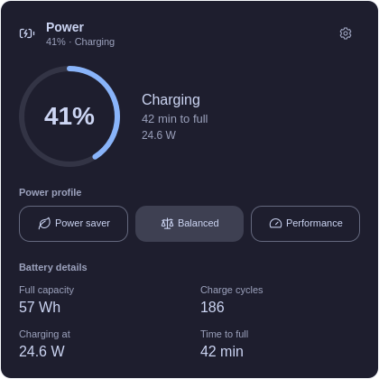

# Foamy Power

Battery status and power profiles for Omarchy 4.5 (also runs on 4.0.6).



## Install

Requires Omarchy 4.5 or 4.0.6, UPower, power-profiles-daemon, `busctl`
(systemd), Python 3 for profile changes, and the Omarchy font's Nerd Font
battery glyphs. Keep Omarchy’s built-in battery service enabled for automatic
profile switching.

```sh
omarchy plugin add https://github.com/foamrider/foamy-power.git --enable
```

Remove any previous power widget from the bar. The widget hides when no system
battery is present.

## Use

- Left-click to see battery readings and choose a power profile.
- Profile selections last until the power source changes.
- Open the cog to set separate AC and battery defaults and bar percentage.
- Enable **Show percentage in the bar** to reveal **Show only when battery is low**. The second option limits the percentage to 10% or below while discharging.
- Right-click to toggle the percentage on horizontal bars.
- In the panel, the arrow keys or H/J/K/L move the cursor across the profiles,
  Enter or Space applies one, S opens settings, R retries after an error, Tab
  or Shift+Tab switches to the neighbouring bar panel and Escape closes.

Percentage preferences are stored in `shell.json`. Power defaults
use Omarchy’s existing files in `~/.local/state/omarchy/powerprofiles` (or the
configured state directory), written atomically. The plugin's action lock lives
in `$XDG_RUNTIME_DIR/foamy-power.lock`, never in Omarchy's state directory.
Plugging in or unplugging applies the matching default.
Charge limits and cycle counts are read from sysfs when available; the plugin
does not change them.

Readings come from Quickshell's UPower and PowerProfiles services in the shell
itself: nothing polls, and no helper runs while you only look. One `busctl`
read of the active profile runs at startup, after a change, on a power-source
change and on **Retry** (as Omarchy 4.5's battery service does). One service
serves every monitor's bar.

## Development

```sh
node tests/model.test.js
node tests/i18n.test.cjs
python3 -m unittest discover -s tests -p 'test_*.py'
python3 tests/integration.py        # helper + Omarchy 4.0.6 battery service, stubbed busctl
python3 tests/i18n-runtime.py
python3 tests/runtime.py            # needs foamy-kit (FOAMY_KIT, default ~/GitHub/Personal/foamy-kit)
bash tests/kit-check.sh
omarchy-plugin-validate "$PWD"
```

Shared components come from [foamy-kit](https://github.com/foamrider/foamy-kit)
as stamped copies in `kit/`; don't edit them here. `preview/Preview.qml`
renders mock states with the kit's preview harness.

## Remove

```sh
omarchy plugin remove foamy.power
```

Restore the stock power widget through the bar settings if needed. The selected
power profile and saved AC/battery defaults remain in place. Omarchy's stock
battery service continues to apply those defaults when the power source changes.

Omarchy manages the plugin entry in `shell.json`. Packages and data outside
the plugin directory are retained unless you remove them separately.

## License

Licensed under [MIT](LICENSE). Omarchy and Lucide notices are in
[LICENSE-OMARCHY](LICENSE-OMARCHY) and [LICENSE-LUCIDE](LICENSE-LUCIDE).

Provided **as is**, without warranty or guaranteed support. Use at your own risk.

Language follows **Omarchy → Setup → Language** on Omarchy 4.5. Plugin language overrides are no longer used. Omarchy 4.0 displays the plugin in English. Missing translations fall back to English.

Translation checks: `python3 tests/i18n-runtime.py` uses the installed shell. Set `OMARCHY_PATH` to a 4.5 source tree to check live language switching against that version.
