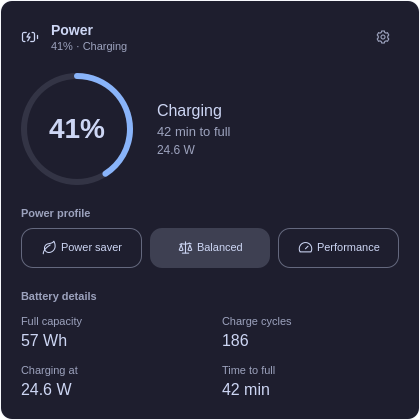

# Foamy Power

Battery status and power profiles for Omarchy 4.5.



The stock **Super+Ctrl+P** shortcut opens Foamy Power when enabled. The plugin declares itself as the `omarchy.power` replacement, so Omarchy also restores the stock widget when the replacement is removed.

## Install

Requires Omarchy 4.5, UPower, power-profiles-daemon, `busctl`
(systemd), an x86_64 or aarch64 CPU for profile changes (the plugin ships a
prebuilt static helper for both; on other CPUs the widget still shows
readings and says the helper isn't available), and the Omarchy font's Nerd
Font battery glyphs. Keep Omarchy’s built-in battery service enabled for
automatic profile switching.

```sh
omarchy plugin add https://github.com/foamrider/foamy-power.git --enable
```

Remove any previous power widget from the bar. The widget hides when no system
battery is present.

## Use

- Left-click to see battery readings and choose a power profile.
- Profile selections last until the power source changes.
- Open the cog to set separate AC and battery defaults and bar percentage.
- Enable **Show percentage in the bar** to reveal **Show only when battery is low**. The second option limits the percentage to 10% or below while discharging.
- Right-click to toggle the percentage on horizontal bars.
- In the panel, the arrow keys or H/J/K/L move the cursor across the profiles,
  Enter or Space applies one, S opens settings, R retries after an error, Tab
  or Shift+Tab switches to the neighbouring bar panel and Escape closes.

IPC (`omarchy-shell foamy.power <fn>` on 4.5, `qs ipc call foamy.power <fn>`):
`open`, `close`, `toggle`, `settings`, `refresh`, `togglePercentage`.

Percentage preferences are stored in `shell.json`. Power defaults
use Omarchy’s existing files in `~/.local/state/omarchy/powerprofiles` (or the
configured state directory), written atomically. The plugin's action lock lives
in `$XDG_RUNTIME_DIR/foamy-power.lock` (without a runtime directory,
`~/.cache/foamy-power/action.lock`), never in Omarchy's state directory.
Plugging in or unplugging applies the matching default.
Charge limits and cycle counts are read from sysfs when available; the plugin
does not change them.

Readings come from Quickshell's UPower and PowerProfiles services in the shell
itself: nothing polls, and no helper runs while you only look. One `busctl`
read of the active profile runs at startup, when the panel opens, after a
change, on a power-source change and on **Retry** (as Omarchy 4.5's battery
service does). One service serves every monitor's bar.

## Development

`kit/` holds shared components copied from [foamy-kit](https://github.com/foamrider/foamy-kit); edit them there, not here.

Profile changes run `bin/<arch>/foamy-power-helper`, a Rust helper built from
`native/` (its contract is the comment at the top of `native/src/main.rs`).
The binaries are committed; after changing `native/` or syncing the kit,
rebuild and commit them with `native/native.pin` (needs rustup; see the kit's
"Native helpers"):

```sh
kit/native/build-native.sh . --test   # fmt, clippy, cargo test
kit/native/build-native.sh .          # both arches, writes native/native.pin
kit/native/build-native.sh . --verify # clean rebuild is byte-identical
```

Tests (Python 3 and node are needed for development only):

```sh
node tests/model.test.js
node tests/i18n.test.cjs
python3 -m unittest discover -s tests -p 'test_*.py'   # helper as a process, fake busctl
FOAMY_HELPER='["bin/aarch64/foamy-power-helper"]' python3 -m unittest discover -s tests -p 'test_*.py'  # via qemu binfmt
python3 tests/integration.py        # helper + the installed 4.5 battery service, stubbed busctl
python3 "$FOAMY_KIT/preview/i18n_runtime.py" .   # catalogs, live language switch
python3 tests/runtime.py            # offscreen on 4.5, needs foamy-kit (FOAMY_KIT, default ~/GitHub/Personal/foamy-kit)
bash tests/kit-check.sh
omarchy-plugin-validate "$PWD"
```

The tests target Omarchy 4.5: the installed `/usr/share/omarchy` (set
`OMARCHY_PATH` for another tree, or `FOAMY_HOST_45` for another shell in
`runtime.py`). `runtime.py 4.0` and `runtime.py both` run 4.0 only against an
Omarchy 4.0 shell tree in `FOAMY_HOST_40`, and print a SKIP line without one.

Shared components come from [foamy-kit](https://github.com/foamrider/foamy-kit)
as stamped copies in `kit/`; don't edit them here. `preview/Preview.qml`
renders mock states with the kit's preview harness.

## Verifying the helper binaries

`bin/x86_64/foamy-power-helper` and `bin/aarch64/foamy-power-helper` are compiled from the Rust source in this repository: `native/`, the
shared crate in `kit/rust/`, the dependencies locked in `Cargo.lock` and the
toolchain pinned in `rust-toolchain.toml`, with the build tool in
`kit/native/`. The build is reproducible. `native/native.pin` records the
toolchain, a hash of every build input (`source`) and the SHA-256 of each
binary.

**CI.** The [Verify native helpers](https://github.com/foamrider/foamy-power/actions/workflows/verify-native.yml)
workflow rebuilds both binaries on a GitHub-hosted runner for every push,
compares them byte for byte with `bin/`, and attests the rebuilt files. To
check the committed files against that attestation (GitHub CLI):

```sh
gh attestation verify bin/x86_64/foamy-power-helper --repo foamrider/foamy-power \
  --signer-workflow foamrider/foamy-power/.github/workflows/verify-native.yml \
  --deny-self-hosted-runners
gh attestation verify bin/aarch64/foamy-power-helper --repo foamrider/foamy-power \
  --signer-workflow foamrider/foamy-power/.github/workflows/verify-native.yml \
  --deny-self-hosted-runners
```

Add `--source-digest <commit>` to require a particular commit.

**Yourself.** You need `rustup`, Python 3.11 or newer and `file`. From a
checkout of this repository at the commit you want to check:

```sh
rustup toolchain install "$(awk '$1 == "toolchain" { print $2 }' native/native.pin)" \
  --profile minimal --target x86_64-unknown-linux-musl,aarch64-unknown-linux-musl
kit/native/build-native.sh . --verify
```

It builds both binaries from scratch in `~/.cache/foamy-native/` (nothing is
written to the checkout), compares them byte for byte with `bin/`, checks
that the kit files are unmodified and that `native.pin` matches the source,
and ends with `verify OK (foamy-power-helper, <toolchain>, both arches reproducible)`.

### Building the helper yourself

To run binaries you built instead of the committed ones, build them in the
installed plugin with the same toolchain, then run `omarchy restart shell`:

```sh
cd ~/.config/omarchy/plugins/foamy.power
kit/native/build-native.sh .
```

The build is reproducible, so `git status` shows no change when your
binaries match the release, and `omarchy plugin update` still applies.

## Remove

```sh
omarchy plugin remove foamy.power
```

Restore the stock power widget through the bar settings if needed. The selected
power profile and saved AC/battery defaults remain in place. Omarchy's stock
battery service continues to apply those defaults when the power source changes.

Omarchy manages the plugin entry in `shell.json`. Packages and data outside
the plugin directory are retained unless you remove them separately.

## License

Licensed under [MIT](LICENSE). Omarchy and Lucide notices are in
[LICENSE-OMARCHY](LICENSE-OMARCHY) and [LICENSE-LUCIDE](LICENSE-LUCIDE).

Provided **as is**, without warranty or guaranteed support. Use at your own risk.

Language follows **Omarchy → Setup → Language**. Plugin language overrides are no longer used. Missing translations fall back to English.

Translation checks: foamy-kit's `preview/i18n_runtime.py .` checks live language switching on the installed shell.
